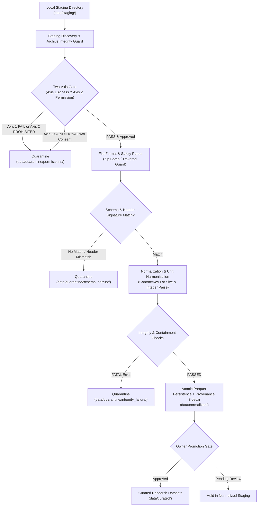

# P2.2.10: Offline Ingestion Engine Specification & Data Pipeline Design

**Milestone:** P2.2.10 (Offline Ingestion Engine Specification & Data Pipeline Design)  
**Repository:** `nifty_quantum`  
**Date:** November 2026  
**Auditor Classification:** Cautious Quantitative-Market-Data Auditor & Documentation Engineer  
**Constraint Baseline:** ₹0 Budget | Offline Staged Files Only | Existing Google Sign-In Allowed Externally | Zero New Accounts | Specification Only (Zero Implementation)  
**Status:** **SPECIFICATION COMPLETE — NOT IMPLEMENTED**

---

## 1. Architectural Philosophy & Operational Boundaries

This document defines the architectural specification for an **offline-only data ingestion and normalization engine** for `nifty_quantum`. 

### 1.1 Non-Implementation Status
**This milestone is strictly a design specification.** No ingestion code, parser scripts, network routines, or data processing pipelines are implemented in this milestone. No files are downloaded or promoted.

### 1.2 The Offline-Only Principle
1. **Zero Network Ingestion:** The ingestion engine operates strictly on local files already placed into a designated local staging directory (`data/staging/`). The engine **must never** initiate outbound HTTP/HTTPS requests, execute web scraping, crawl portals, query undocumented APIs, or programmatically access Google Drive or cloud storage.
2. **Decoupling Acquisition from Ingestion:**
   - Data acquisition is an out-of-band, manual operational step performed exclusively by the repository owner under verified terms of service.
   - An existing Google account sign-in (or Google Drive download) is acceptable as an external manual mechanism for the owner to stage files. The ingestion engine itself only sees local bytes on disk.
3. **Immutability of Baseline Data:** The ingestion engine operates in isolated staging workspaces (`data/staging/` $\to$ `data/normalized/`). It **must never mutate, overwrite, or delete** existing P1 or P2 datasets in `data/raw/p1_nse/`, `data/reference/`, or `data/derived/candles/`.

---

## 2. Ingestion Pipeline Architecture & Directory Layout

The ingestion architecture enforces a strict four-tier data segregation hierarchy:

```
+---------------------------------------------------------------------------------------------------+
| FOUR-TIER DATA WORKFLOW ARCHITECTURE                                                             |
+-------------------+-------------------------------------------------------------------------------+
| Tier 1: STAGING   | Path: data/staging/<domain_id>/<source_id>/                                   |
|                   | Holds raw, unmodified external files (ZIPs, CSVs, Parquet) manually placed    |
|                   | by the owner. Accompanied by staging manifest. Read-only to parser.          |
+-------------------+-------------------------------------------------------------------------------+
| Tier 2: QUARANTINE| Path: data/quarantine/<domain_id>/<timestamp>/                                |
|                   | Holds files that failed permission gates, schema validation, checksums, or    |
|                   | lot-size cohort resolution. Isolated from analytical feature generation.       |
+-------------------+-------------------------------------------------------------------------------+
| Tier 3: NORMALIZED| Path: data/normalized/<domain_id>/                                            |
|                   | Parsed, unit-harmonized, tick-validated, standardized Parquet files with       |
|                   | immutable JSON provenance sidecars. Intermediate research staging.            |
+-------------------+-------------------------------------------------------------------------------+
| Tier 4: CURATED   | Path: data/curated/ (or data/derived/)                                        |
|                   | Formally promoted, verified research data. Promotion requires explicit owner  |
|                   | approval gate. Zero files are promoted during P2.2.10.                         |
+-------------------+-------------------------------------------------------------------------------+
```



---

## 3. Staging Ingestion Contract & Discovery Engine

### 3.1 Input Directory Contract
Files must be staged according to a deterministic directory naming convention:
`data/staging/<DOMAIN_ID>/<SOURCE_ID>/<RAW_FILENAME>`
*Example:* `data/staging/DOMAIN_K/SRC-K1-NSE-ARCHIVE/BhavCopy_NSE_FO_0_0_0_20240710_F_0000.csv.zip`

### 3.2 Discovery & File Manifest
1. The ingestion engine scans `data/staging/` deterministically (sorted lexicographically by path).
2. For each discovered file, it computes:
   - File size in bytes (`raw_file_size_bytes`);
   - Cryptographic SHA-256 digest (`source_sha256`) computed over the raw file bytes on disk;
   - Initial magic-byte file signature (identifying ZIP, CSV, or Parquet).
3. **Idempotency & Duplicate Prevention:**
   The engine maintains an immutable registry index (`data/staging/.ingestion_registry.json`). If a file with an identical `source_sha256` has already been ingested into `data/normalized/`, the engine skips re-processing unless an explicit `--force-reprocess` flag is provided with a new engine version tag.

---

## 4. Archive Safety & Defensive Decompression

To prevent denial-of-service vulnerabilities on developer workstations (especially student-tier Windows machines), all archive extraction routines must pass four safety gates before reading contents:

1. **Path Traversal Protection (Zip Slip Guard):**
   - Every archive member path is validated. Any member containing `../`, `..\\`, absolute drive roots (e.g. `C:\`), or leading slashes is immediately rejected, and the entire archive is routed to `data/quarantine/security/`.
2. **Zip Bomb & Expansion Ratio Guard:**
   - Uncompressed size is inspected from archive central directory headers before decompression.
   - **Max Uncompressed Size:** Single file extraction limit is capped at **2.0 GB**.
   - **Max Expansion Ratio:** The ratio of uncompressed size to compressed size must not exceed **25:1**. Archives exceeding this threshold trigger `SECURITY_EXPANSION_RATIO_EXCEEDED` and fail closed.
3. **Streaming In-Memory Decompression:**
   - Archives containing CSV files (e.g. daily bhavcopy `.csv.zip`) are decompressed via streaming buffers without writing intermediate raw uncompressed CSVs to arbitrary temporary directories.
4. **File Count Boundary:**
   - Single archive packages must contain at most **10 files**. Archives containing thousands of nested files trigger an immediate security quarantine.

---

## 5. Normalization, Validation Severity & Quarantine Model

### 5.1 Five-Tier Validation Severity Model

```
+---------------+---------------------------------------------------------------------------------------+
| Severity Level| Operational Pipeline Action                                                           |
+---------------+---------------------------------------------------------------------------------------+
| FATAL         | Structural corruption, missing mandatory header, negative prices/volumes, invalid     |
|               | dates. Batch processing immediately aborts; file moved to data/quarantine/.           |
+---------------+---------------------------------------------------------------------------------------+
| QUARANTINE    | Legal permission unverified (CONDITIONAL without consent), unmapped lot-size cohort,  |
|               | or schema signature mismatch. File isolated; no normalized dataset produced.          |
+---------------+---------------------------------------------------------------------------------------+
| WARNING       | High volume divergence against EOD totals, session dropouts, or non-consecutive       |
|               | timestamps. Normalized output generated but flagged with warning metadata.            |
+---------------+---------------------------------------------------------------------------------------+
| DIAGNOSTIC    | Informational tracking metrics (e.g. 15:29 Close vs 30m VWAP drift, participant      |
|               | aggregate long/short discrepancy). Metrics logged; zero impact on file acceptance.   |
+---------------+---------------------------------------------------------------------------------------+
| ACCEPTED      | All schema, containment, tick, lot, and unit checks pass cleanly. File written to      |
|               | data/normalized/ with validated provenance sidecar.                                   |
+---------------+---------------------------------------------------------------------------------------+
```

### 5.2 Atomic Write Engine & Crash Recovery
To prevent partial, corrupt, or half-written Parquet files during unexpected process termination or Windows system restarts:
1. All normalized outputs and provenance sidecars are written to a temporary sibling file:
   `data/normalized/<DOMAIN>/<FILE>.parquet.tmp_<UUID>`
2. Only after file writing, Parquet footer verification, and SHA-256 sidecar generation succeed is the file atomically renamed to:
   `data/normalized/<DOMAIN>/<FILE>.parquet`
3. Any lingering `.tmp_*` files detected at engine startup are purged to quarantine before new runs.

---

## 6. Resource Governance for Developer Workstations

To ensure predictable performance on Windows laptops and student workstations:
1. **Memory Ceiling:** Peak resident memory per ingestion worker is capped at **2.0 GB**.
2. **Chunked Processing:** Large CSV archives (such as full-market cash bhavcopies with 50,000+ rows) are read using streaming iterators with `chunksize = 10,000` rows.
3. **Single-Threaded Determinism:** Multiprocessing is disabled by default to ensure reproducible error logs, prevent Windows file-locking conflicts (`PermissionError: [WinError 32]`), and maintain ordered provenance generation.
4. **Compression Standard:** All normalized intermediate files are serialized using Apache Parquet with **Snappy** compression, preserving native date/integer column encodings.

---

## 7. The Owner Promotion Gate (Staging to Curated)

The ingestion engine terminates its workflow at `data/normalized/`. It **does not promote** data into curated research directories (`data/curated/` or `data/derived/`).

### Promotion Prerequisites (Enforced Out-of-Band):
1. **Axis 2 Permission Verification:** The owner has verified that data-use terms permit algorithmic simulation for the specific dataset.
2. **Provenance Sidecar Intact:** SHA-256 checksums match physical bytes.
3. **Zero FATAL or QUARANTINE Flags:** Ingestion summary report confirms clean validation status.
4. **Explicit Owner Authorization:** Promotion requires manual confirmation (e.g. running an explicit promotion CLI command with `--approve-dataset`).

