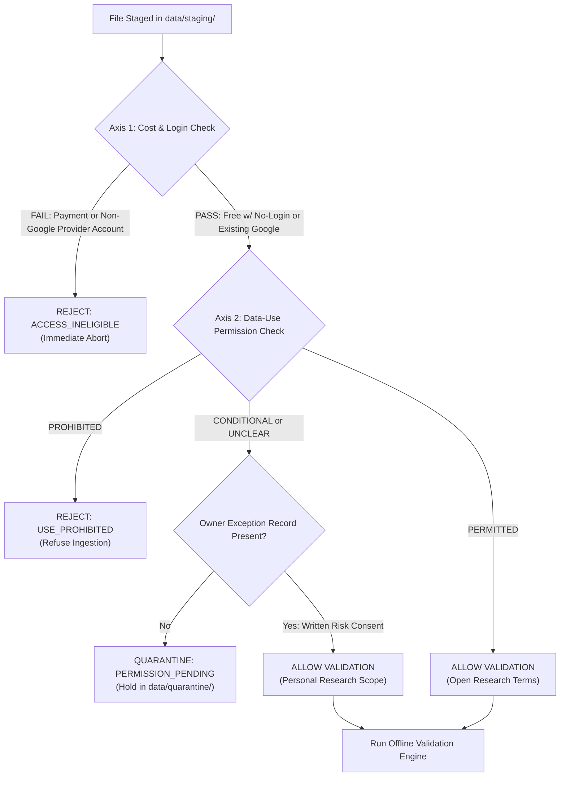

# P2.2.10: Staging Verification, Provenance Architecture & Promotion Gates

**Milestone:** P2.2.10 (Offline Ingestion Engine Specification & Data Pipeline Design)  
**Repository:** `nifty_quantum`  
**Date:** November 2026  
**Auditor Classification:** Cautious Quantitative-Market-Data Auditor & Documentation Engineer  
**Constraint Baseline:** ₹0 Budget | Offline Staged Files Only | Existing Google Sign-In Allowed Externally | Specification Only (Zero Implementation)  
**Status:** **SPECIFICATION COMPLETE — NOT IMPLEMENTED**

---

## 1. The Two-Axis Access & Rights Ingestion Gate

Before any staged file in `data/staging/` can be processed by a parser adapter, it must pass through the **Two-Axis Source Gate**.



### 1.1 Gate Evaluation Logic
```
IF Axis 1 fails (requires payment, subscription, paid API, or new provider-specific account):
    REJECT immediately; record failure code ACCESS_INELIGIBLE.
ELSE IF Axis 1 passes BUT Axis 2 is PROHIBITED (e.g. paywalled tick data or reverse-engineered scrapers):
    REFUSE ingestion; record failure code USE_PROHIBITED.
ELSE IF Axis 2 is CONDITIONAL or UNCLEAR (e.g. NSE website terms restricting storage in retrieval systems):
    IF explicit owner risk-acceptance file (e.g. data/staging/<DOMAIN>/.owner_permission.json) is present:
        ALLOW ingestion strictly for private personal academic research.
    ELSE:
        QUARANTINE file into data/quarantine/permissions/; DO NOT process into normalized datasets.
ELSE IF Axis 2 is PERMITTED (e.g. RBI DBIE or Hugging Face CC-BY-NC-4.0):
    ALLOW ingestion; enforce attribution and non-commercial tracking tags.
ELSE:
    Default fail-closed to QUARANTINE / NOT_APPROVED.
```

### 1.2 Google Sign-In & Google Drive Clarification
- An existing Google account sign-in (or Google Drive download) satisfies **Axis 1 only**.
- Accessing a file hosted on Google Drive does **not** grant a copyright license or alter **Axis 2**. If a third party uploads copyrighted exchange data to Google Drive without permission, accessing it via Google sign-in remains legally conditional/unclear.
- Manual browser download does **not** automatically make local retention or quantitative simulation lawful.

---

## 2. Quantitative Integrity Contracts: Lot Size, Tick Size & Gaps

### 2.1 Contract-Cohort Lot Size Resolution Contract
Lot size cannot be resolved from a naive global calendar date because multiple lot sizes co-exist on the same date during transition windows (e.g., 2024-11-22 to 2025-01-30).

```
IF per-row NewBrdLotQty is present and > 0 (UDiFF bhavcopies):
    Use NewBrdLotQty as authoritative observed lot. (estimated = False, basis = BASIS_OFFICIAL_ROW).
ELSE IF contract cohort is unambiguously covered by an expiry issuance circular:
    Use verified cohort lot size. (estimated = False, basis = BASIS_EXPIRY_COHORT).
ELSE IF contract falls within modal date regime (data/reference/nifty_lot_history.csv):
    Use modal lot size; tag output with estimated = True and basis = BASIS_DATE_REGIME.
    NOTE: Records with estimated = True are EXCLUDED from strict financial validation gates.
ELSE:
    Mark lot size as UNKNOWN; QUARANTINE contract rows (LOT_SIZE_UNKNOWN_FAIL_CLOSED).
```

### 2.2 Exact Decimal & Integer-Paise Tick Validation Contract
To avoid floating-point rounding bugs and prevent silent masking of sub-paise corruption:
1. **String / Decimal Pre-Check:**
   - Verify that raw price strings have at most 2 decimal digits (`scale <= 2`).
   - If any price contains 3 or more decimal places (e.g. `18245.054`), trigger `SUB_PAISE_PRECISION_ERROR` and reject.
2. **Binary Float Tolerance Check:**
   - If input is binary float (e.g. Parquet), verify: $|(\text{price} \times 100) - \text{round}(\text{price} \times 100)| \le 10^{-5}$.
   - If out of tolerance, trigger `FLOAT_SUB_PAISE_CORRUPTION` and reject.
3. **Integer Divisibility:**
   - Compute $\text{price\_paise} = \text{int}(\text{round}(\text{price} \times 100))$ and $\text{tick\_paise} = \text{int}(\text{round}(\text{expected\_tick} \times 100))$.
   - Verify $\text{price\_paise} \pmod{\text{tick\_paise}} == 0$.

### 2.3 Strict Zero-Imputation Gap Policy
- Tradable OHLC prices must **never** be forward-filled or synthesized across missing minute bars.
- Gaps must be tagged according to the repository's completeness taxonomy:
  - `NO_TRADES`: Valid zero-volume interval; no candle generated.
  - `MISSING_DAYS`: Unobserved trading day; fail-closed rejection.
  - `TRUNCATED_SESSION`: Session ends before 15:25 IST; exclude day from intraday strategy runs.
  - `MARKET_WIDE_HALT`: Verified market halt; accepted without defect penalty.
  - `PRESENT_WITHOUT_OI`: Bar with `open_interest == 0`. Excluded from OI-derived features; never forward-filled.

---

## 3. Immutable Provenance Sidecar Specification (`.provenance.json`)

Every normalized file written to `data/normalized/` must be paired with an immutable JSON sidecar.

### 3.1 Complete Provenance Sidecar Schema Template

```json
// ILLUSTRATIVE TEMPLATE — NOT A REAL INGESTION RECORD
{
  "$schema": "https://nifty-quant.local/schemas/provenance-v1.json",
  "artifact_id": "<UUID_V4>",
  "artifact_name": "fo_bhav_YYYYMMDD.parquet",
  "domain_id": "DOMAIN_K",
  "source_id": "SRC-K1-NSE-ARCHIVE",
  "canonical_url": "<CANONICAL_SOURCE_URL>",
  "raw_archive_member": "<INNER_MEMBER_PATH_IF_ZIP>",
  "fetch_timestamp_utc": "<ISO_8601_TIMESTAMP>",
  "download_method": "manual_browser_export",
  "axis1_access_status": "PASS_NO_LOGIN",
  "axis2_permission_status": "CONDITIONAL_PERSONAL_RESEARCH",
  "permission_evidence_ref": "P2.2.9_SOURCE_PERMISSION_AUDIT.md#domain-k",
  "license_tag": "NSE_WEBSITE_TOS_PERSONAL_RESEARCH",
  "attribution_requirement": "None (Proprietary Exchange Data; Personal Non-Commercial Research Only)",
  "source_sha256": "<COMPUTE_SHA256_FROM_ACTUAL_SOURCE_BYTES>",
  "normalized_parquet_sha256": "<COMPUTE_SHA256_OF_PARQUET_FILE>",
  "raw_file_size_bytes": "<ACTUAL_BYTE_COUNT>",
  "detected_schema_name": "UDIFF_FO_BHAVCOPY_V1",
  "schema_signature_hash": "<HEADER_HASH>",
  "row_count_raw": "<INTEGER_RAW_ROWS>",
  "row_count_normalized": "<INTEGER_NORMALIZED_ROWS>",
  "volume_unit_raw": "shares",
  "oi_unit_raw": "shares",
  "lot_size_resolution_authority": "OBSERVED_ROW_NEWBRDLOTQTY",
  "validation_engine_version": "1.0.0",
  "validation_severity_verdict": "ACCEPTED",
  "validation_flags": [],
  "parent_lineage": []
}
```

---

## 4. Multi-Stage Promotion Gate (Staging to Curated)

Promotion from intermediate staging (`data/normalized/`) to the curated research layer (`data/curated/` or `data/derived/`) represents a formal operational boundary.

```
+---------------------------------------------------------------------------------------------------+
| PROMOTION GATE CHECKLIST (ALL CRITERIA MANDATORY)                                                 |
+----+-----------------------------+----------------------------------------------------------------+
| #  | Gate Requirement            | Verification Standard                                          |
+----+-----------------------------+----------------------------------------------------------------+
| 1  | Legal Permission Clearance  | Axis 2 is PERMITTED, or owner-signed CONDITIONAL consent file. |
| 2  | Cryptographic Integrity     | Physical file SHA-256 matches provenance sidecar record.       |
| 3  | Zero FATAL / QUARANTINE     | Validation log confirms 0 fatal errors and 0 quarantine flags. |
| 4  | Exact Unit Harmonization    | Both contract counts and share counts resolved and populated.  |
| 5  | Calendar Alignment          | Trading date verified against official NSE trading calendar.  |
| 6  | Non-Destructive Write       | Promotion target does not overwrite any existing baseline file.|
| 7  | Explicit Owner Authorization| Manual confirmation via CLI flag (--approve-promotion).        |
+----+-----------------------------+----------------------------------------------------------------+
```

### Confirmation:
**Zero datasets are promoted during P2.2.10.** All components described in this document constitute design specifications awaiting implementation in a future milestone.

