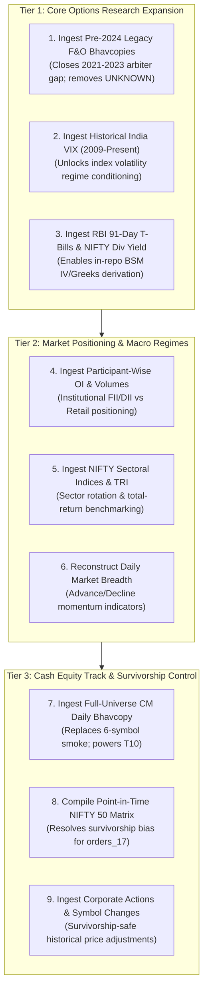

# P2.2.8 — Source Discovery Executive Decision

**Milestone:** P2.2.8 — Free Historical Data Source Discovery  
**Date:** 2026-11-07  
**Author:** Quantitative Research Data Auditor  
**Decision Scope:** Strategic evaluation of newly discovered ₹0 unauthenticated data sources, ranked implementation sequencing, and boundaries of permanent research constraints.

---

## 1. Executive Summary

The P2.2.8 discovery audit investigated thirteen quantitative data domains (A through M) against the strict constraints of **₹0 budget, no accounts/logins, no broker APIs, and legally defensible non-commercial research use**.

The investigation yielded **two major breakthroughs**, verified several high-value official public datasets, and definitively confirmed the boundaries of what is permanently impossible under ₹0 constraints:

1. **The Pre-2024 Arbiter Breakthrough (Domain K):**
   Prior milestones established a "verification floor" of 2024-01-02 because the modern UDiFF bhavcopy endpoint returns 404 for earlier dates. This audit discovered that NSE maintains daily F&O bhavcopies for **2021, 2022, 2023, and through July 5, 2024 on the legacy path** (`/content/historical/DERIVATIVES/YYYY/MON/foDDMONYYYYbhav.csv.zip`). This unlocks independent official arbitration for the entire 2021–2023 option archive at ₹0 without an account.
2. **The Option Pricing Inputs Breakthrough (Domains C & D):**
   Defensible official inputs for Black-Scholes implied volatility inversion—specifically the **91-day sovereign Treasury Bill auction cut-off yields from RBI** (Domain C) and **daily historical NIFTY 50 dividend yields from NSE Indices** (Domain D)—were confirmed freely available from 1999 to present without credentials.
3. **Firm Boundaries Confirmed (Domains B & L):**
   Observed contract-level IV/Greeks, historical bid/ask quotes, spreads, and order-book depth exist in **no free, lawful, unauthenticated source**. They are exclusively commercial paid products. Any future contract IV/Greeks must be model-derived estimates, and execution must continue to rely on bar-OHLC + slippage models.

---

## 2. What Can Be Sourced at ₹0 Without Accounts

Every source below was independently verified as publicly reachable, downloadable in CSV/ZIP format, free of charge, and requiring no login, registration, or API token:

| Dataset / Domain | Official Publisher | Direct URL / Access Point | Historical Span | Format |
|---|---|---|:---:|:---:|
| **India VIX Daily OHLC** (Domain A) | National Stock Exchange of India (NSE) | `https://www.nseindia.com/reports-indices-historical-vix` | 2009-03-02 → Present | CSV / JSON API |
| **Pre-2024 Legacy F&O Bhavcopy** (Domain K) | National Stock Exchange of India (NSE) | `https://nsearchives.nseindia.com/content/historical/DERIVATIVES/` | 2000 → 2024-07-05 | CSV inside ZIP |
| **Post-2024 UDiFF F&O Bhavcopy** (Domain K) | National Stock Exchange of India (NSE) | `https://nsearchives.nseindia.com/content/fo/` | 2024-01-01 → Present | CSV inside ZIP |
| **91-Day T-Bill Primary Auction Yields** (Domain C) | Reserve Bank of India (RBI DBIE) | `https://data.rbi.org.in/` | 1990s → Present | CSV / XLS |
| **NIFTY 50 Historical Dividend Yield & P/E** (Domain D) | NSE Indices Limited | `https://www.niftyindices.com/reports/historical-data` | 1999-01-01 → Present | CSV |
| **Participant-Wise Derivatives OI & Volume** (Domain E) | NSE Clearing Limited (NSCCL) | `https://nsearchives.nseindia.com/content/nsccl/fao_participant_*.csv` | 2014-07-09 → Present | CSV |
| **Sector Indices & Total Returns Index (TRI)** (Domain F) | NSE Indices Limited | `https://www.niftyindices.com/reports/historical-data` | 1999/2000 → Present | CSV |
| **Daily Capital Market (Cash Equity) Bhavcopy** (Domain H) | National Stock Exchange of India (NSE) | `https://nsearchives.nseindia.com/content/cm/` & `/EQUITIES/` | 2000s → Present | CSV inside ZIP |
| **Corporate Actions, Symbol Changes & Delistings** (Domain J) | National Stock Exchange of India (NSE) | `https://www.nseindia.com/content/equities/symbolchange.csv` | 1994 → Present | CSV |
| **Macroeconomic Policy Rates & CPI** (Domain M) | Reserve Bank of India (RBI DBIE) | `https://data.rbi.org.in/` | 1990s → Present | CSV / XLS |

---

## 3. What Cannot Be Sourced at ₹0 (Permanent Hard Blockers)

The quantitative audit confirmed that the following research inputs **do not exist in any free, lawful, and complete form**:

1. **Observed Contract-Level Historical IV and Greeks (Domain B):**
   - The exchange publishes historical prices, volumes, and open interest, but **not** historical contract IV or Greeks.
   - Commercial data vendors charge annual subscription fees (>₹20,000 to ₹1,00,000+) for pre-computed Greeks.
   - *Resolution under ₹0:* Contract IV and Greeks must be **calculated in-repo via Black-Scholes inversion** from observed premium, spot, strike, DTE, risk-free rate (Domain C), and dividend yield (Domain D). Such values are **model-derived estimates**, must be stored separately (Rule H5), and cannot be treated as observed exchange quotes.
   - *Reminder:* India VIX is an index-level benchmark, **not** an input to Black-Scholes contract IV inversion.
2. **Historical Bid/Ask Quotes, Spreads, and Order-Book Depth (Domain L):**
   - Historical Level-2 / Level-3 order-book depth and tick-level bid/ask quotes are strictly proprietary, paid exchange feeds.
   - Live NSE depth is ephemeral (not archived for free download).
   - *Resolution under ₹0:* Order-book market impact and crossed-spread execution cannot be simulated at ₹0. Execution modelling must remain bounded by bar-OHLC and declared slippage bps.
3. **Multi-Year Intraday Expired Options Beyond the Existing Archive (Domain L):**
   - The Hugging Face archive (`thetrademarkk/india-index-options-1m`, CC-BY-NC-4.0) remains the **sole identified ₹0 source** for multi-year 1-minute NIFTY option candles.
   - Cloud Trader Pro requires Google account authentication (violating the no-account constraint).
   - Broker APIs (Breeze, Upstox, Dhan) require funded demat accounts and developer subscriptions, and their master files do not support expired contract chains anonymously.
   - *Resolution under ₹0:* The short-DTE window per expiry (~1–2 weeks) is a data boundary that must be accepted. Statistical power must be built through breadth across expiries rather than expecting deep multi-month intraday history per contract.

---

## 4. Prioritised Implementation Roadmap (For Future Milestones)

To maximize quantitative research value while preserving the integrity of the project, candidate sources should be ingested in distinct, sequential phases:

### Tier 1: Core Options Research Expansion (Immediate High-Value)
1. **Pre-2024 Legacy F&O Bhavcopy Ingestion (Domain K):**
   - *Action:* Ingest `foDDMONYYYYbhav.csv.zip` from `nsearchives.nseindia.com` for 2021-05 through 2023-12.
   - *Impact:* Validates all pre-2024 options contracts against exchange records; converts 2021–2023 contract-days from `UNKNOWN` to verified status; resolves the lot size and settlement arbiter gap.
2. **India VIX Daily History (Domain A):**
   - *Action:* Ingest official daily VIX series (2009–present) from NSE / `^INDIAVIX`.
   - *Impact:* Unlocks volatility-regime conditioning in `validation/regime.py`.
3. **Option Pricing Parameters (Domains C & D):**
   - *Action:* Ingest RBI 91-Day T-bill yields and NIFTY 50 dividend yields.
   - *Impact:* Enables mathematically defensible, in-repo Black-Scholes contract IV and Greek estimation.

### Tier 2: Market Positioning & Breadth (Medium-Term Enhancement)
4. **Participant-Wise Open Interest & Volumes (Domain E):**
   - *Action:* Ingest daily clearing archives (`fao_participant_oi/vol`).
   - *Impact:* Provides quantitative institutional sentiment metrics (FII net long/short index futures ratio).
5. **Sector Indices & Total Return Indices (Domain F):**
   - *Action:* Ingest daily TRI series for major sectors.
   - *Impact:* Enhances market regime context and relative-strength analysis.
6. **Market Breadth Reconstruction (Domain G):**
   - *Action:* Compute daily Advance/Decline counts from cash equity bhavcopies.

### Tier 3: Cash Equity Research & Survivorship Control (Prerequisite for T10)
7. **Full-Universe Cash Equity Bhavcopy (Domain H):**
   - *Action:* Ingest multi-year CM bhavcopies for all NSE equities.
   - *Impact:* Replaces 3-symbol smoke with full universe (T10).
8. **Point-in-Time Constituent Compilation & Corporate Actions (Domains I & J):**
   - *Action:* Compile semi-annual reconstitution announcements into `nifty50_pit_membership.csv`; map `symbolchange.csv` and `delisted.csv`.
   - *Impact:* Eliminates survivorship bias and unblocks `orders_17`.

---

## 5. Explicit Boundary Conditions & Non-Violations

To preserve complete compliance with user instructions:
- **No data was downloaded, scraped, or ingested during this milestone.**
- **No accounts or credentials were created.**
- **No codebase logic, tests, or configurations were modified.**
- **No strategy screening, backtesting, or Monte Carlo runs were executed.**
- **The owner's Git checkpoint `18386c9` remains untouched.**

Awaiting user review and authorization before initiating any subsequent milestone.

