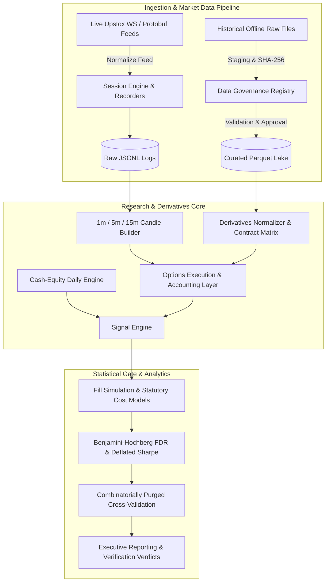

# NIFTY QUANT (P2.2 Options & Cash-Equity Backtesting Engine)

> **Autonomous, fail-closed quantitative research, market data ingestion, and rigorous backtesting engine for NSE cash equity and NIFTY derivatives.**

[](https://www.python.org/)
[](#test-suite--quality-gates)
[](#data-governance--safety-architecture)
[](#license)

---

## 📌 Overview

**NIFTY QUANT** is a research-grade options and equities quantitative platform engineered specifically for the National Stock Exchange of India (NSE). It bridges historical simulation with live execution readiness through deterministic data governance, strict statutory cost modeling (STT, GST, Stamp Duty, SEBI turnover, exchange fees), and multi-horizon validation (Benjamini-Hochberg FDR, Deflated Sharpe Ratio, combinatorially purged cross-validation).

### ⚠️ Scope & Operational Philosophy
* **Pure Quantitative Research & Backtesting**: Built for hypothesis testing, signal validation, statistical arbitrations, and high-fidelity historical replay.
* **Non-Custodial & Read-Only**: Implements read-only analytics ingestion via Upstox v2 WebSocket protocol. No order placement, brokerage routing, trade execution, or external capital controls exist.
* **Fail-Closed Governance**: Data without established legal provenance, valid access status (Axis 1/2), verified SHA-256 signatures, or complete candle conservation will abort execution rather than contaminate research.

---

## 🏗️ System Architecture



---

## ⚡ Key Capabilities

### 1. Market Data & Streaming Engine (`nifty_quant.market_data`)
* **Upstox V2 Binary Protocol**: High-throughput protobuf decoding and feed normalization.
* **Adaptive Reconnection & Backoff**: Exponential jitter backoff (1s–30s) resilient to network drops.
* **Live Session Lifecycle**: Automatic state tracking across `PRE_OPEN`, `REGULAR_TRADING`, `CLOSING_PRINT`, and `POST_MARKET` sessions.
* **Deterministic Aggregations**: 1-minute, 5-minute, and 15-minute grids constructed with strict left-edge labeling and terminal closing print preservation.

### 2. Strict Offline Ingestion & Governance (`nifty_quant.ingestion`)
* **Dual-Axis Permission Framework**:
  * **Axis 1 (Accessibility)**: Strict authentication requirement audits (`PASS_NO_LOGIN`, `FAIL_LOGIN_GATED`).
  * **Axis 2 (Usage Rights)**: Terms-of-service compliance tracking (`PERMITTED`, `CONDITIONAL_PERSONAL_RESEARCH`, `FORBIDDEN`).
* **Atomic Hard-Link Promotion**: Exclusively employs collision-resistant hard-links (`os.link`) with provenance sidecars. Never falls back to destructive overwrites (`os.replace`).
* **Quarantine Isolation**: Automatic eviction of malformed artifacts with tamper-evident audit logs.

### 3. Realistic NSE Cost & Execution Engine (`nifty_quant.engine`, `nifty_quant.options`)
* **Statutory Expense Era Matrix**: Accurately reproduces pre- and post-October 2024 STT hikes, GST, SEBI turnover fees, stamp duty, and exchange transaction fees.
* **Contract Reference Database**: Historical lot sizes (e.g., NIFTY lot sizes moving between 50, 25, 75), strike steps, and weekly/monthly expiry calendars.
* **Realistic Options Execution**: Slippage penalties, intrinsic/extrinsic value bounds, and liquidity volume caps.

### 4. Overfitting Prevention & Validation Suite (`nifty_quant.validation`)
* **False Discovery Rate (FDR)**: Benjamini-Hochberg adjustment across all strategy trials.
* **Probabilistic & Deflated Sharpe Ratios**: Corrects for track record length, skewness, kurtosis, and data mining variance.
* **Combinatorial Purged Cross-Validation (CPCV)**: Rigorous train/test partitioning with embargo buffers to eliminate lookahead bias.

---

## 🚀 Getting Started

### Prerequisites
* **Python**: 3.12 or higher
* **OS**: Linux, macOS, or Windows 10/11
* **Virtual Environment**: Recommended (`venv` or `uv`)

### Installation

1. **Clone the repository**:
   ```bash
   git clone https://github.com/your-username/nifty_quantum.git
   cd nifty_quantum
   ```

2. **Create and activate a virtual environment**:
   ```bash
   python -m venv .venv
   # Windows PowerShell
   .venv\Scripts\Activate.ps1
   # Linux/macOS
   source .venv/bin/activate
   ```

3. **Install dependencies**:
   ```bash
   pip install -r requirements.txt
   ```

4. **Configure environment variables** (optional for live collection):
   ```bash
   cp .env.example .env
   # Edit .env and supply UPSTOX_API_KEY / UPSTOX_REDIRECT_URI if running live market data
   ```

---

## 💻 CLI Usage

The market data service provides a unified entry point:

```bash
# Check market data engine status and authentication state
python -m nifty_quant.market_data status

# Query active contracts and subscription universe
python -m nifty_quant.market_data instruments --symbol NIFTY --type OPT

# Run a live recording session (requires configured access token)
python -m nifty_quant.market_data collect --duration 375m --output data/raw/session_today.jsonl

# Validate integrity of a captured feed session
python -m nifty_quant.market_data validate data/raw/session_today.jsonl

# Reconstruct 1m, 5m, and 15m Parquet candles from a recording
python -m nifty_quant.market_data candles data/raw/session_today.jsonl --output data/curated/
```

---

## 🧪 Test Suite & Quality Gates

The codebase contains an exhaustive, deterministic offline test harness guaranteeing zero leakage, deterministic accounting, and mathematical correctness.

```bash
# Run the complete test suite (690+ tests)
python -m pytest -q

# Run focused ingestion & data governance tests
python -m pytest -v tests/test_ingestion_registry.py

# Run live market data engine tests
python -m pytest -v tests/test_market_data_*.py

# Run options accounting & cost engine tests
python -m pytest -v tests/test_options_*.py tests/test_costs.py
```

### Coverage Highlights
* **694 unit & integration tests** covering feed normalization, option Greeks/settlement, statutory charge schedules, and lookahead guards.
* **Cross-platform support**: Native isolation for Windows privilege constraints and POSIX filesystems.

---

## 📁 Repository Structure

```text
nifty_quantum/
├── nifty_quant/                     # Core Python Package
│   ├── analytics/                   # Performance attribution, drawdowns, equity curves
│   ├── derivatives/                 # Contract matrix, expiry calendars, settlement rules
│   ├── engine/                      # Cash-equity simulation, order routing, portfolio accounting
│   ├── ingestion/                   # Data governance, provenance sidecars, quarantine, curated lake
│   ├── market_data/                 # Upstox WebSocket engine, protobuf parser, candle aggregators
│   ├── options/                     # Derivatives execution adapters, pricing, statutory cost engine
│   ├── reporting/                   # Markdown/HTML report generators, audit packaging
│   ├── research/                    # Alpha pipeline, feature extraction, dataset transformers
│   ├── signals/                     # Signal generator schemas, threshold evaluators
│   ├── strategies/                  # Strategy implementations (e.g. bracket trend, momentum)
│   └── validation/                  # Deflated Sharpe, Benjamini-Hochberg, CPCV embargo splits
├── tests/                           # Exhaustive pytest test harness (694 tests)
├── data/                            # Local storage (raw feeds, staging, curated Parquet)
├── artifacts/                       # Smoke run outputs and historical validation baselines
├── scripts/                         # Operational verification & benchmark utilities
├── requirements.txt                 # Pinned dependencies
├── pytest.ini                       # Test runner configuration
└── README.md                        # Project documentation
```

---

## ⚖️ License

**Proprietary & Confidential.** All rights reserved. Intended strictly for private non-commercial quantitative research.

